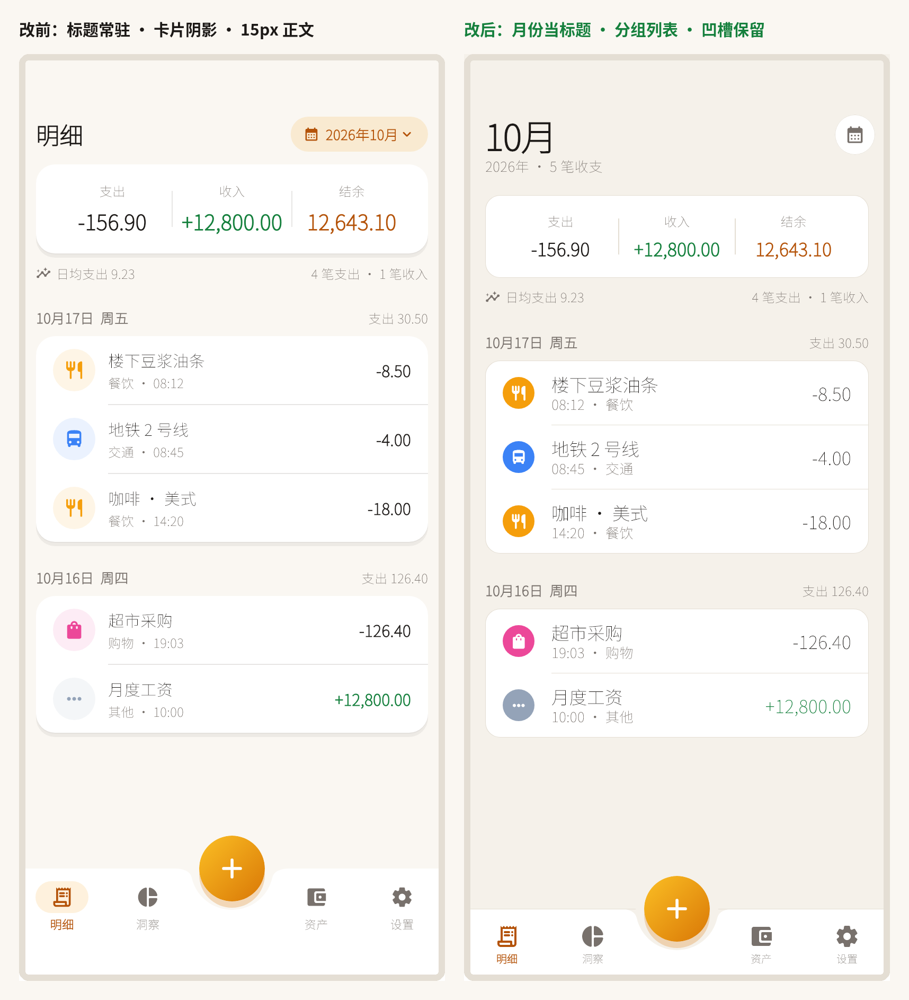

# 果味与标题：两个方向的改造方案

> **状态（2026-10-17）：批 1 + 批 2 已落地**，其中「底部凹槽」按你的偏好**保留**——只换材质，不拆凹槽。
> 结论先行：
> **果味不是"换一套 Cupertino 组件"，而是 6 个可感知细节的合集**——字体、材质、密度、控件、动效、克制用色。你这版最大的三个"非果味"信号是：**Material 的卡片+阴影语言、没有大标题、控件与转场还是 Android 的**。
> **标题可以全删，但必须做"锚点替换"**：用月份/金额当标题，用 tab 高亮做定位，用大标题收起做滚动反馈。删标题本身不难，难的是删完之后第一屏还得有重心。



> 已落地的具体做法与遗留项见 §六、§七；凹槽的处理见 §五.1。

---

## 一、为什么现在看着"不像 iOS"

| 层 | iOS 的做法 | 你现在 | 差距 |
|---|---|---|---|
| 字体 | SF Pro：大标题 34/bold、正文 17、辅助 13，负字距 | 22/17/15/13，Material 字阶，字距 0 | 字号偏小、没有大标题，视觉重心贴在左上角 |
| 材质 | 分组列表 + 发丝线（0.5px）+ 毛玻璃，几乎不用阴影 | 每块内容一张卡 + 两层柔和阴影 | "卡片语言"是 Material 的指纹 |
| 密度 | 行高 44–56、边距 20、组间距 26–32 | 行高 64（含内边距）、边距 16 | 偏"信息面板"，不够松弛 |
| 控件 | Cupertino 分段/开关/滚轮/动作表 | 自绘 Material 风控件 | 一眼能看出不是系统控件 |
| 动效 | 弹簧（~0.35s，轻微回弹）+ 交互式返回 + 橡皮筋滚动 | `AnimatedContainer` 150ms，滚到底硬停 | 缺"手感" |
| 用色 | 系统 tint + 语义色，彩色只出现在图标/数字 | 品牌金出现在多处块面 | 品牌感够，系统感不足 |

> 顺带一个容易忽略的点：Material 主题默认字族是 Roboto，**iOS 上 SF 不会自动接管**。iOS 用户对字形极其敏感，英文与数字显示成 Roboto 是最先被察觉的"非原生"信号。

---

## 二、六层改造清单（按"一眼看出"排序）

### P0 · 半天内能看到差别

| 项 | 改法 | 你的落点 |
|---|---|---|
| 大标题 | 页面顶部放 34/bold，滚动时收成导航栏小标题 | 明细=月份、资产=净资产、洞察=本月支出 |
| 分组列表 | 卡片去阴影，只用发丝线分隔；行高 56；分隔线从 62px 起（对齐图标右边） | `BeanCard` 的 `boxShadow` 换成 `Border.all(0.5)`/`Divider(0.5)` |
| 字号档位 | 34 / 22 / 17 / 15 / 13 / 11，全部负字距 −0.2～−0.6 | `app_theme.dart` 的 `textTheme` |
| 底栏 | 毛玻璃 + 顶部 0.5 发丝线 + 图标 24/文字 10，去掉选中胶囊底 | `bean_bottom_nav.dart` |
| 页面转场 | iOS 横向推入 + 手滑返回 | `pageTransitionsTheme: CupertinoPageTransitionsBuilder()` |
| 字体 | iOS 端切到 Cupertino 系统字族（引擎映射到 SF），Android 保持系统字 | `theme.copyWith(textTheme: ...fontFamily)`，按 `defaultTargetPlatform` 分支 |

### P1 · 一天，靠"手感"而非"截图"

| 项 | 改法 |
|---|---|
| 控件 | 分段、开关、日期时间、动作表用 Cupertino 版（`CupertinoSlidingSegmentedControl` / `CupertinoSwitch` / `CupertinoDatePicker`） |
| 滚动 | `BouncingScrollPhysics(parent: AlwaysScrollableScrollPhysics())`，列表顶部下拉不回弹到硬边 |
| 大标题收起 | `CupertinoSliverNavigationBar(largeTitle: ...)`；Material 侧对应 `SliverAppBar.large` |
| 弹簧动效 | 记账成功/保存用 `SpringSimulation`（damping≈0.85），不要 `easeInOut` |
| 触觉 | 已有 `selectionClick` / `lightImpact`，再补「保存成功」`mediumImpact` |

### P2 · 细节控

- 数字：`tabularFigures` + 负号用 `−`（U+2212），金额右对齐；`¥` 比数字小 40%。
- 图标：线宽统一 2.0、尺寸 24（SF Symbols 的圆角端点感，Material Rounded 已接近，别混 filled/outlined）。
- 圆角：iOS page sheet 约 10–12，Material bottom sheet 是 28——你现在 28 是"安卓 14 观感"，改成 16 会立刻更像 iOS 的卡片式 sheet。
- 状态栏/滚动条：滚动条隐藏或极细（iOS 默认几乎看不见）。

---

## 三、"标题"该不该有：先把标题的活儿拆开

页面标题其实干三件事，删之前先给它们找接替者：

1. **定位**（我在哪）→ 底部 tab 已经在做，标题是重复信息（"明细"出现两次，界面立刻显得没设计过）。
2. **层级**（内容从这里开始）→ 用大标题/发丝线/留白建立起点。
3. **锚点**（视觉重心）→ 用**数字**替代：月份、本月支出、净资产。

### 四个替身（可组合）

| 方案 | 做法 | 适合 | 风险 |
|---|---|---|---|
| **A 内容即标题**（推荐） | 大标题放本月/本数字：`10月`、`¥156.90`、`¥26,520.15` | 明细 / 洞察 / 资产 | 内容为空时要给占位文案 |
| **B 大标题收起**（推荐） | 滚动后收成导航栏小标题 + 毛玻璃 | 明细 / 洞察 / 资产 | 需要 sliver + 滚动监听 |
| C tab 即标题 | 顶部完全不放东西 | 极简页（如设置里的子页） | 滚动后完全失去定位 |
| D 上下文小字 | 13px 灰字：`2026年 · 4 笔收支` | 只能当辅助，不单独承担 | 单独用会"没有标题感" |

### 具体到四个 Tab

- **明细**：删「明细」→ 大标题 `10月` + 副行 `2026年 · 4 笔收支`；右上角圆形日历按钮替代原来的金色月份胶囊（胶囊是 Material 的"chip 语言"）。
- **洞察**：大标题 `¥156.90` + 副行 `本月支出 · 10月`；图表直接开始，不再有"洞察"三个字。
- **资产**：大标题 `¥26,520.15`（净资产）+ 副行 `本月 +12.4%`。
- **设置**：**保留标题**。设置是"入口列表"，没有数字可当锚，删了会真的空。
- **记一笔面板**：`记一笔` 也可以删——分段控件 + 金额已经说明身份。想留就留，但别再额外加一行说明文字。

### 防"奇怪"的 6 条

1. **顶部必须留呼吸区**：删标题后仍有 12–20 的留白，否则内容像被裁掉。
2. **锚点字号要压得住**：替代标题的东西 ≥ 28px，否则整页没有重心。
3. **滚动要给反馈**：大标题收起 / 顶部毛玻璃出现，否则用户不知道自己在哪。
4. **tab 高亮要够重**：图标+文字+颜色三重强调，弱了就丢定位。
5. **一级页无标题、二级页必须有**：详情页要 `← 标题`，层级感靠这个建立。
6. **空状态自带句子**：「还没有记账」本身就是标题，别让空页真的空。

> 如果只想改一处：**把「明细」换成 `10月` 大标题，其他先不动**。成本 10 分钟，果味立刻出来一半。

---

## 四、Flutter 落点（可直接抄）

```dart
// 1) 字体：iOS 用 Cupertino 系统字族（引擎映射到 SF），Android 走系统字
final family = defaultTargetPlatform == TargetPlatform.iOS
    ? 'CupertinoSystemText'
    : null;
final textTheme = ThemeData.light().textTheme.apply(fontFamily: family);

// 2) 大标题 + 收起
CustomScrollView(slivers: [
  const CupertinoSliverNavigationBar(largeTitle: Text('10月')),
  SliverList(...),
]);

// 3) 毛玻璃底栏
ClipRect(
  child: BackdropFilter(
    filter: ImageFilter.blur(sigmaX: 20, sigmaY: 20),
    child: Container(
      decoration: BoxDecoration(
        color: palette.surface.withValues(alpha: 0.86),
        border: Border(top: BorderSide(color: line, width: 0.5)),
      ),
      child: ...,
    ),
  ),
);

// 4) 发丝线
const Divider(height: 0.5, thickness: 0.5, color: Color(0xFFE3DED6));

// 5) 转场 + 橡皮筋
theme.copyWith(
  pageTransitionsTheme: const PageTransitionsTheme(builders: {
    TargetPlatform.iOS: CupertinoPageTransitionsBuilder(),
    TargetPlatform.android: CupertinoPageTransitionsBuilder(), // 想统一就都改
  }),
);
ScrollConfiguration(
  behavior: const ScrollBehavior().copyWith(physics: const BouncingScrollPhysics()),
  child: list,
);

// 6) 弹簧保存动效
final sim = SpringSimulation(
  const SpringDescription(mass: 1, stiffness: 260, damping: 22),
  controller.value, 1, 0,
);
controller.animateWith(sim);
```

---

## 五、代价与取舍

| 选择 | 好处 | 代价 |
|---|---|---|
| 只借 iOS 的视觉（推荐） | 双端一致、维护一套、品牌资产不丢 | 不算"纯血 iOS" |
| 整套 CupertinoApp | 最像 iOS | Android 上违和；两套控件维护成本翻倍 |
| 平台自适应控件 | 各自原生 | 需要为每个控件写两套分支，QA 翻倍 |

建议：**结构/间距/字体/动效统一走 iOS 那一套；只有"控件行为"按平台分支**（iOS 用 Cupertino 组件，Android 用 Material）。这样既有一致的品牌观感，又不会在 Android 上出现"假 iOS"的违和。

### 5.1 凹槽为什么保留，以及怎么保留

金豆"嵌"进底栏是品牌资产，果味改造**不动它**，只换材质。落地时踩到一个真实问题：

- 原来金豆挂在 `Scaffold.floatingActionButton` 上，Scaffold 的绘制顺序是 body → FAB → bottomNavigationBar，**底栏会盖住金豆的投影**，只剩凹槽里一弯月牙；
- 现在金豆改由 `BeanBottomNav` 自己的 Stack 绘制（底栏在下、发丝线在中、金豆在最上），投影完整；
- 凹槽换成固定圆心的 `_BeanNotchedShape`（圆心 = 底栏顶边正中），不再依赖 Scaffold 的 FAB 几何量，所以能脱离 `floatingActionButton` 单独用；
- 顶边 0.5px 发丝线在凹槽处**断开 78px**（62 的金豆 + 两侧各 8），线不会横穿凹槽。

---

## 六、已落地（2026-10-17）

| 项 | 落地方式 | 落点 |
|---|---|---|
| 字号档位 | 34/22/17/15/13/11，负字距 −0.2～−0.6 | `lib/theme/app_theme.dart` `_beanTextTheme` |
| 字体分支 | iOS 用 `CupertinoSystemText`（映射 SF），其他平台跟随系统 | 同上 |
| 卡片 | 去阴影，改 0.5px 发丝线 + 14 圆角 | `lib/widgets/common.dart` `BeanCard` |
| 分组底色 | `#FAF7F2` → `#F5F1EA`，白卡片才立得住 | `lib/theme/tokens.dart` |
| 行高/边距 | 行高 56、页面边距 20、组间距 26 | `BeanSpace` |
| 分类图标 | 实心分类色圆 + 白色字形（列表行） | `CategoryAvatar` |
| 大标题 | `BeanLargeTitle`：明细=月份、洞察=本月支出、资产=净资产、设置保留 | 四个页面 |
| 底栏 | 凹槽保留；图标 24 / 文字 10 / 金色文字选中；顶边发丝线在凹槽断开 | `BeanBottomNav` |
| 转场 | `CupertinoPageTransitionsBuilder` | `buildBeanTheme` |
| 图表 | 环形图改用降饱和 `chartColors`，和图例统一 | `insights_page.dart` |

## 七、还没做

- **大标题随滚动收起**（`CupertinoSliverNavigationBar`）：现在是静态大标题，滚动时不会变成导航栏小标题；
- **Cupertino 控件替换**：分段/开关/日期仍是用主题色自绘，行为一致但手感不是 iOS 原生；
- **弹簧动效 + 橡皮筋滚动**：`BouncingScrollPhysics` 只在 iOS 生效，Android 要显式配置；
- **毛玻璃**：底栏现在是 0.92 不透明 + 发丝线，没有 `BackdropFilter`（性能与凹槽裁剪都要额外处理）。

原型文件：`test/tools/ios_preview.dart`（只用于截图对比，不接 App）。
图片：`docs/review/title-compare.png`（改前 vs 改后），逐张截图在 `docs/review/shots/10-*`、`12-15`。
