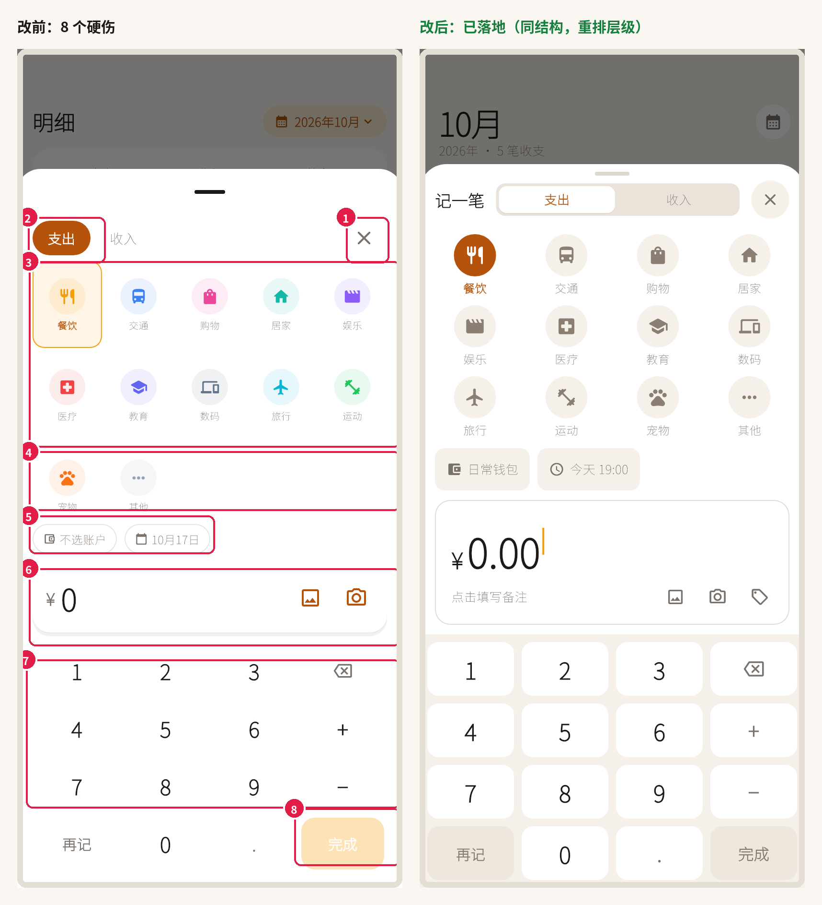

# 记账面板设计评审 · 「添加一笔记账」

> 评审对象：`lib/widgets/quick_entry_sheet.dart`（金豆一次点击直达的记账面板）
> 参照物：`docs/images/添加一笔记账/1–4.jpg`（四款成熟记账 App 的同一场景）
> 截图全部由 `test/tools/capture_screens_test.dart` 真实渲染（402×874 @2x），不是手绘稿。
> **状态：评审结论已全部落地**（2026-10-17）；同一轮又补了账户/时间选择。只余 M1 数据层与 M7 视觉识别。



**一句话结论**：原来的结构和交互骨架是对的（金额优先、键盘就位、再记/完成并列），但**视觉层级是反的**——最重的元素是"支出/收入"，最该被看见的"金额"和"键盘"反而最轻；同时有 3 处"元素与背景同色"，它们不是审美问题，是可用性问题。

---

## 一、四张参照图在做什么

| 参照 | 骨架 | 值得注意的是 |
|---|---|---|
| [1.jpg](../images/添加一笔记账/1.jpg) | 分类网格 → 账户/账本/日期/计入收支一行 → 金额卡 → 键盘 | 彩色**插画**图标 + 同色系淡圆底；元信息是**一行 4 个胶囊**、全部是正向文案 |
| [2.jpg](../images/添加一笔记账/2.jpg) | 全屏页 + 顶部"支出/收入"下划线 tab + 灰阶图标网格 | 图标**全灰阶**，只有金额（红）和保存（红）是彩色；键盘白键 + 浅灰底座 |
| [3.jpg](../images/添加一笔记账/3.jpg) | 底部 sheet + 圆形 X + 胶囊分段 + 主/子分类 + 备注行 + 元信息胶囊 + 键盘 | 选中态是**实心圆填充**；功能项拆成 ⌫、(＋×）、(−÷) 分组；完成是实心红 |
| [4.jpg](../images/添加一笔记账/4.jpg) | tab 胶囊 + 选中绿 + 子分类面板 + 标签行 + 元信息行 + 键盘 | 选中 = 淡绿圆底 + 绿色文字；未选中 = 灰圆底 + 灰图标，"新增"占满最后格 |

**它们共同的 6 条规则**（原来缺的）：

1. **同屏只有一个强调色**，且只给"选中项 + 主按钮"。其余图标一律灰阶或插画级质感。
2. **类型切换必须轻**：下划线 tab 或白胶囊分段。没有一款把"支出"做成实心品牌色按钮——那是主按钮的语法。
3. **键盘永远有底座**：白键 + 浅灰底，或灰键 + 白底。键的边界必须肉眼可见。
4. **金额是唯一的大字号**，且带输入光标/`0.00` 占位，让人知道"这里在等我打字"。
5. **元信息是一排 40px 胶囊**：账户、账本/时间、计入收支——文案全部正向、可点。
6. **键盘钉在底部，内容不整体滚动**；只有分类区可滚。

---

## 二、8 个硬伤（图上编号对应，全部已修）

### ① 三个关闭入口，却没有标题
拖拽条 + 右上角 X + 点击遮罩，三条退出路径；而面板里没有一句"这是什么"。X 还放在右手拇指最难够到的右上角。
→ **已修**：`记一笔` 标题 + 右上 40px 圆形关闭键；拖拽条自己画（`neutral.handle`），不再用 Material 默认的冷灰 `onSurfaceVariant`。

### ② "支出/收入"是全屏最重的色块
原来 `_TypePill` 选中态用 `goldDeep` 实心 + 白字，而 `goldDeep` 是规范里的**主按钮背景**。类型切换抢走了「完成」的语义，也抢走了金额的注意力。
→ **已修**：改成 34px 高的轻量分段控件（`sand` 轨 + 选中白胶囊 + `goldDeep` 文字，不反白）。

### ③ 分类区：12 色彩虹 + 描边方框选中
- 12 个高饱和分类色同屏，图标对比实测约 2.0:1（金 1.99、绿 2.07），低于图形元素 3:1。
- 选中态是 1px 金色**描边方框**——"焦点框/错误框"的语法；同屏还有三种选中语言（实心胶囊 / 描边框 / 淡色底）。
→ **已修**：未选中 = 砂色圆 + 暖灰图标（3.5:1 ✓）；选中 = **金色实心圆 + 白图标 + 金色文字**。颜色策略见 §五。

### ④ 5 列 × 12 项：第三行 60% 是空的
12 个分类排成 2 行 + 1 行只有 2 个，右侧一大片死白，面板却仍为 3 行付高度。
→ **已修**：**4 列 × 3 行 = 正好 12**，格高 74、图标圆 44、标签 12（原来 10px）。小屏时分类区内部滚动。

### ⑤ 账户/日期胶囊：负向文案 + 27px 高
"不选账户"是在描述"你没做什么"；胶囊 27px，低于 44px 下限；日期写死 `10月17日`；只有日期没有时间，而列表行每行都显示 `08:12`。
→ **已修**：`[👛 默认账户] [🕘 今天 HH:mm]`，高 44、圆角 10、13px/w500，时间取 `DateTime.now()`。

### ⑥ 金额卡和面板同白，只剩一圈断掉的阴影
卡片与 sheet 同为 surface，边界只能靠阴影表达；两个金色图标比金额更抢眼。
→ **已修**：白底 + 1px `lineStrong` 描边 + 圆角 16；金额 42/w700 + 2×30 金色光标；相册/相机收进**备注行**（44×44），不再是两个飘着的金色图标。

### ⑦ 键帽 = 面板色，按键"消失"
按键用 `palette.surface`，与 sheet 同色 → 数字浮在白上，没有边界、没有"这是键盘"的心理模型。
→ **已修**：`sand` 底座 + 白键（暗色为 `raised`）+ 圆角 12 + 键高 56 + 8 间距。
> 暗色补丁：暗色下"键帽比底座暗"会读成**凹陷**，所以新增 `neutral.raised`（亮色白 / 暗色 `#352F2A`）。

### ⑧ 禁用的"完成"几乎看不见
禁用态是 `gold @30% + 白字`，实测约 **1.3:1**，第一眼像"按钮坏了"。
→ **已修**：禁用 = `disabledBg` + `disabledFg`（亮 3.4:1 / 暗 3.8:1）；可用态 `goldDeep` + 白字（5:1），暗色用 `goldDark` + 深字（5.4:1）。

---

## 三、其余问题（已一并处理）

| 级别 | 问题 | 处理 |
|---|---|---|
| P1 | 整面板在 `SingleChildScrollView` 里，小屏时**键盘会滚走** | 外层 `Column` + 分类区 `Flexible`（上限 3 行），键盘永远贴底 |
| P1 | 「再记」的 SnackBar 在 modal sheet **之下**，用户看不到"已记一笔" | 改成**备注行内联确认**（绿色 ✓，1.8s 淡出），不用 SnackBar |
| P1 | 默认分类/类型写死，规范要求"继承上次值" | `QuickEntrySheet(initialCategory / initialIsIncome)`，`shell.dart` 记住上次提交 |
| P1 | 分类标签 10px | 12px / w500，选中 w700 |
| P2 | 运算符出现时卡片高度跳 18px | 运算行固定占 18px |
| P2 | ⌫ 图标 19px | 21px，`textSecondary` |
| P2 | 类型切换热区约 34px | 分段视觉 34、热区 44（`Semantics` 保留 button/selected） |
| P2 | 无触感反馈 | 数字/运算符/分类切换 `HapticFeedback.selectionClick()`；提交 `lightImpact()` |
| P2 | 金额无光标、无 `0.00` | 已加 |
| P3 | 面板圆角 24 与卡片 18 不一致 | sheet 顶部圆角 28（token 化说明见 DESIGN.md §5） |
| P3 | `CategoryAvatar` 淡底 10% vs 规范 8% | 列表行保持 10%（小圆点，视觉更稳）；规范里注明"网格用灰阶、列表用 10% 淡底" |

---

## 四、备注与标签：怎么落的

需求是"备注要给上传图片、选择标签留位置"。落法是**参照 1 / 参照 3 的做法**：备注不单独占一行，而是做金额卡的第二行。

```
┌───────────────────────────────────┐
│  ¥ 0.00▏                          │  ← 金额 + 光标（唯一的大字号）
│  点击填写备注          🖼  📷  🏷  │  ← 备注文案 + 图片/相机/标签（各 44×44）
└───────────────────────────────────┘
```

- **备注**：点文字弹出输入弹窗（`TextFormField`，40 字上限）。用弹窗而不是内联输入框，是为了**不把系统键盘叫出来顶掉数字键盘**。
- **图片 / 相机**：仍然"点即识别"（M0 骨架，M7 接真实模型）。
- **标签**：预设多选（出差/报销/聚餐/礼物/家庭/旅行/工作/理财），选中后以 `#聚餐 #报销` 金色前缀显示在备注行，标签图标变金色。
- **再记**：清空金额/备注/标签，分类与类型保留；确认文案落在备注行，**不遮挡任何内容**。
- 备注与标签随这笔账一起提交：`onSubmit(amount, isIncome, categoryIndex, note, tags)`。

这样处理的好处：截图里能一眼看到"金额 → 备注 → 键盘"三段，和参照 1/3 的输入区完全同构，也没有多占一行高度。

---

## 五、两个取舍（已按推荐决定）

### 取舍 1：分类图标保留 12 色吗？

**决定：网格内灰阶 + 金色选中（方案 A）。** 颜色留给"一次只出现一个"的地方（交易列表行、图表、图例）——
一次看 12 个时颜色只是噪声，一次看 1 个时颜色才是记忆锚点。这也是参照 2/3/4 的做法。
未采用方案 B（保留分类色但统一降饱和），因为它只能把噪声变小，不能消掉。

### 取舍 2：还要不要"备注"？

**决定：保留**（原 DESIGN.md 写"不设备注"，已同步修改）。备注并入金额卡第二行，图片/相机/标签全部收在这一行，
不再出现"两个金色图标没有家、只能挤在金额旁边"的问题。

---

## 六、改后（已落地）

| | 改前 | 改后 |
|---|---|---|
| 头部 | 无标题；拖拽条 + 右上 X | `记一笔` + 轻分段控件 + 40px 圆形 X |
| 分类 | 5 列、12 色、描边选中、10px 标签 | 4×3、灰阶 + 金色实心选中、12px 标签、圆 44 |
| 元信息 | 2 个 27px 描边胶囊，"不选账户" | 2 个 44px 实底胶囊：默认账户 / 今天 HH:mm |
| 金额 | 32px，白底无边界，运算行 12px | 42px + 光标 + 描边输入框，运算行固定 18px |
| 备注 | 无 | 金额卡第二行：备注文案 + 图片 / 相机 / 标签 |
| 键盘 | 白键 = 白底，键不可见 | 砂色底座 + 白键（暗色 `raised`）+ 56px 键高 |
| 完成 | 禁用态 1.3:1 | 禁用态 3.4:1；可用态 `goldDeep`（暗色 `goldDark`） |
| 再记 | SnackBar（被面板挡住） | 备注行内联确认 |

细节截图：
[改前](shots/00-before-default.png) ·
[改后（默认）](shots/01-entry-default.png) ·
[改后（运算符）](shots/02-entry-operator.png) ·
[改后（收入）](shots/03-entry-income.png) ·
[改后（备注 + 标签）](shots/04-entry-note.png) ·
[改后（再记确认）](shots/05-entry-toast.png) ·
[改后（暗色）](shots/06-entry-dark.png) ·
[改后（小屏 375×667）](shots/07-entry-small.png) ·
[账户选择](shots/08-entry-account.png) ·
[时间选择](shots/09-entry-time.png)

### 新增 token（`BeanNeutral`，已进 `lib/theme/tokens.dart`）

```dart
sand       #F5F1EA / #2A2521   键盘底座、次表面
raised     #FFFFFF / #352F2A   抬升面：白键、分段选中块
lineStrong #E2DBD0 / #45403A   金额卡描边
iconNeutral#8A7F72 / #B4AA9C   未选中分类图标（3.5:1）
disabledBg #EDE7DD / #2E2925   禁用键
disabledFg #857B6C / #8F8579   禁用字（亮 3.4:1 / 暗 3.8:1）
handle     #DED7CB / #4A423A   拖拽条
```

### 关键尺寸

| 元素 | 值 |
|---|---|
| 面板圆角 / 拖拽条 | 28 / 36×4 |
| 分类格 | 高 74，图标圆 44，标签 12 |
| 元信息胶囊 | 高 44，圆角 10，13px |
| 金额 | 42 / w700，`¥` 24，光标 2×30 |
| 备注行 | 高 44，图标按钮 44×44 |
| 键帽 | 高 56，圆角 12，间距 8 |

---

## 七、`DESIGN.md` 已同步的 3 处

| 原来 | 现在 |
|---|---|
| "分类 5 列、最多 3 行" | **4 列 × 3 行**（12 项正好填满） |
| "不设备注输入（保持极简）" | **保留备注**，并入金额卡第二行，标签预设多选 |
| 面板结构只写到"金额卡（含图片识别入口）" | 明确"金额 + **备注行**（图片/相机/标签）"，并补三条不可破的视觉规则 |

---

## 八、改动清单（已全部提交）

**值（第 1 批）**
- [x] 键盘：砂色底座 + 白键 + 56 键高 + 8 间距
- [x] 完成禁用态 `disabledBg/disabledFg`
- [x] 金额 32 → 42，加 `0.00` + 光标
- [x] 分类标签 10 → 12、图标 38 → 44
- [x] 元信息胶囊高 44、文案改正向
- [x] 拖拽条 `neutral.handle`

**结构（第 2 批）**
- [x] 5 列 → 4 列 × 3 行
- [x] 类型 pill → 分段控件
- [x] 金额卡加描边；图片/相机/标签收进备注行
- [x] 标题行 `记一笔` + 40px 圆形关闭

**交互（第 3 批）**
- [x] 去掉外层滚动，键盘贴底
- [x] 时间字段（今天 HH:mm）
- [x] 「再记」内联确认
- [x] 触感反馈（选择 + 提交）
- [x] 分类/类型继承上次值
- [x] 备注弹窗 + 标签多选
- [x] 暗色模式走查（`raised` / `goldDark` 两处专门修过）

**仍待 M1/M7**
- [ ] 备注/标签/账户/时间落库与回显（`QuickEntryDraft` 已带出，等数据层）
- [ ] 标签改为用户自建（依赖存储）
- [ ] 账户/时间继承目前是会话内记忆，落库后改成读「最近一次」
- [ ] 图片识别接真实视觉模型（M7）

---

## 九、第二轮：账户与时间选择

原来两个胶囊点开只是一句「M3 实现」。现在都是真的能改，并用同一套视觉规则（暖灰拖拽条、40 圆关闭键、砂底胶囊、金色选中）。

**选择账户**（[截图](shots/08-entry-account.png)）：底部小面板，一行一个账户——分类圆底图标 + 名称 + 类型（信用卡带还款日）+ 余额；选中打金色钩。余额统一两位小数，负号在 `¥` 前（`-¥3,280.40`），欠款才用警示红。选完立刻回填到面板胶囊，并继承到下一次记账。

**选择时间**（[截图](shots/09-entry-time.png)）：

- 顶部三个快捷胶囊 `今天 / 昨天 / 前天`，点了改日期、**保留当前时分**；
- 下面是日期时间滚轮（中文、24 小时制），精细调整用它；
- 滚轮文字样式取自主题 `titleLarge`，强制跟随 App 亮暗，否则暗色下会黑字黑底；
- 底部整条实心 `完成`（复用键盘主键的样式，不用 Material 默认 FilledButton）。

两个面板都通过 `showModalBottomSheet` 叠在记账面板之上，宽度、圆角、拖拽条与主面板一致；关闭有 X、点遮罩、选完自动关三条路径，和主面板行为对齐。

---

## 十、验收清单（截图已逐条走查）

- [x] 金额是不是全屏唯一 >32px 的文字？
- [x] 键盘白键在亮色/暗色下都能看出边界？
- [x] 禁用态按钮文字对比 ≥3:1？
- [x] 所有可点元素 ≥44×44？（分类格、胶囊、备注行图标、关闭键）
- [x] 375×667 小屏下键盘仍完整可见、不滚动（分类区内部滚动 + 底部淡出提示）
- [ ] 320×568 极窄屏仍需真机再看一次
- [x] 关掉颜色（灰度）后，还能分清"选中分类 / 当前类型 / 主按钮"吗？
- [x] 深色模式截图再走一遍？

---

## 附 · 复现方法

```bash
# 1. 重新渲染截图（会用系统字体 Noto Sans SC，避免测试环境的方块字）
flutter test test/tools/capture_screens_test.dart

# 2. 生成对比图（compare.png）与标注图（annotated-current.png）
python docs/review/make_figures.py
```

- 截图：`docs/review/shots/`（`00-*` 改前，`01–06` 改后）
- 截图脚本：`test/tools/capture_screens_test.dart`
- 图片生成：`docs/review/make_figures.py`
- 实现：`lib/widgets/quick_entry_sheet.dart`、`lib/theme/tokens.dart`（`BeanNeutral`）
